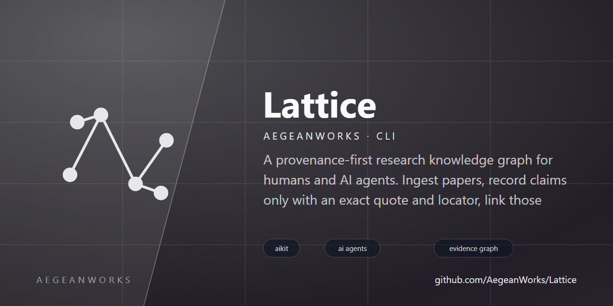

# lattice

<!-- aegean:media:start -->
<p align="center"></p>
<p align="center"><a href="LICENSE"></a> <a href="https://github.com/AegeanWorks/AIKit"></a></p>
<!-- aegean:media:end -->

A provenance-first research knowledge graph for humans and AI agents. Ingest papers, record
claims only with an exact quote and locator, link those claims to research questions, and let
agents query a deterministic evidence graph instead of a pile of summaries.

Lattice is local-first: one SQLite file, the Python standard library, and no network calls.

## 30-Second Cold-Start Quick Reference

- **Runtime Prerequisites**: Python 3.10 or newer (standard library only; no third-party packages)
- **Canonical Regression Shield Gate**:
  ```bash
  python -m unittest discover
  ```
- **UI inventory proof** (the snapshot the AIKit UI guard compares against):
  ```bash
  python tools/ui_inventory.py
  ```
- **Dogfood gate** (drives the real CLI and the live studio server, then attacks them):
  ```bash
  python tools/dogfood.py
  ```
- **Try it now** (under 10 seconds, from this folder):
  ```bash
  # Option A: 1-Click interactive Web Research Studio
  python start.py         # or ./start.sh (Mac/Linux), or double-click start.bat (Windows)

  # Option B: CLI fast path
  python -m lattice init
  python -m lattice question "Does slow-wave sleep consolidate memory?"
  python -m lattice fetch "slow-wave sleep memory" --source offline
  python -m lattice extract --all --question q_000001
  python -m lattice synthesize q_000001
  ```

### AIKit Commands (run from the AIKit folder)

| Role | Command |
|---|---|
| Status, task and gates | `python aikit.py status lattice` |
| Phase 4: every gate | `python aikit.py check lattice` |
| Repair memory and map, then check | `python aikit.py fix lattice` |
| Resume an interrupted task | `python aikit.py resume lattice` |
| Open a bounded studio edit | `python aikit.py ui begin lattice --surface studio` |
| Verify the open studio edit | `python aikit.py ui verify lattice` |
| Close it after a human review | `python aikit.py ui finish lattice --reviewed` |
| Real-usage dogfood gate | `python tools/dogfood.py` |

The UI mechanics are declared in `.aikit/ui.json`: the `studio` surface is bounded to
`lattice/web.py`, every other module is protected, the fast proof is the test suite, and the
snapshot proof (`python tools/ui_inventory.py`) enumerates the studio's element ids, click
handlers, dispatcher routes and theme tokens so a dropped control or route becomes a verify
finding instead of a silent regression.

## How It Works

- **Discovery (`fetch`)** queries offline corpora, arXiv, Crossref, OpenAlex, or EuropePMC (or a
  comma-separated federated list such as `--source offline,openalex,europepmc`) through a 4-layer
  pluggable provider boundary and deduplicates discovered papers automatically.
- **Knowledge Creation (`extract`)** segments abstracts into empirical sentences, infers stance
  (`supports`, `contradicts`, `mentions`) and confidence, records quote-backed claims with
  locators, links matching research questions, and connects each new finding to related findings
  that share a question or enough domain keywords.
- **Papers** carry bibliographic metadata plus searchable tags and a study type (for example
  `Randomized Controlled Trial`, `Cohort Study`, `Meta-Analysis`, `Computational Study`). Explicit
  values win; otherwise the type is inferred from the title and abstract and tags are derived from
  the most informative title/abstract keywords. DOIs, arXiv IDs and normalized title/year pairs are
  deduplicated; a later record fills fields the first one lacked.
- **Claims** are the unit of knowledge. Every claim needs assertion text, an exact source quote
  and optionally a locator and confidence. A claim cannot exist without provenance.
- **Questions** collect evidence. Links such as `supports`, `contradicts` and `answers` connect
  claims to questions; `cites`, `replicates`, `extends`, `uses_method`, `measures`, `mentions`
  and `related` cover the rest of the graph.
- **Analysis (`analyze`)** detects opposing claim pairs (`supports` vs `contradicts`) on shared
  questions or domain keywords (with optional `--auto-link`), links related findings through
  deterministic `related` edges, ranks keystone papers and claims by evidence centrality, and
  builds a `Paper x Question` evidence matrix with coverage gaps.
- **Token-frugal AI context (`outline`)** treats the graph as an external context. An agent peeks
  at a cheap index (counts, edge kinds, study-type mix and evidenced question refs), expands
  compact search or finding snippets that keep a stable `ref`, and pays for full text only by
  drilling into one ref. MCP `search`, `related_findings` and `subgraph` are compact and budgeted
  by default (`tokens` argument), and every trimmed list reports its omissions.
- **Synthesis (`synthesize`)** computes a confidence-weighted consensus score in `[-1.0, 1.0]`,
  groups claims into thematic clusters with verbatim quotes, identifies research gaps and
  follow-up queries, and formats resolved Markdown and BibTeX references.
- **Multi-Format Graph Export & Snapshots (`export` / `import`)** writes and merges portable JSONL
  graph bundles atomically, or exports to standard GraphML (`.graphml`, for Gephi/Cytoscape/NetworkX),
  Cytoscape.js JSON (`.cyjs`), or BibTeX bibliography (`.bib`), with automatic format detection by file
  extension or `--format jsonl|bibtex|graphml|cytoscape`.
- **Snapshot diffing (`diff`)** compares a JSONL snapshot against another snapshot or the live
  graph and reports added, removed and changed papers, questions, claims and edges with the
  changed field names. Comparison ignores the volatile `created_at` field, and the command exits
  with code 1 when the graphs differ, so scripts can gate on it.
- **Web Research Studio (`web`)** serves a local, zero-dependency human UI with a guided
  "Start here" onboarding card, compact header actions behind one overflow menu, short workflow
  tabs, and collapsible import forms so the first screen stays uncluttered. It includes one-click
  demo seeding, multi-source literature discovery, browser paste-ingestion (BibTeX/RIS/CSV/CSL-JSON/Markdown),
  literature search by tag, word, full sentence or study type, a Corpus Outline quick drawer with
  study-type and edge-relation breakdowns, one-click clipboard copy for Markdown and BibTeX syntheses,
  JSONL snapshot download, direct BibTeX export, vector SVG export, interactive SVG subgraph exploration whose
  paper/claim/question nodes carry the study type and whose edges are colored by relation (dashed amber
  for `related`) with a legend and a Connect Findings action, and a `Paper x Question` Evidence Matrix
  & Contradictions tab.
- **The gate (`check`)** reports broken endpoints, missing quotes, duplicate identifiers,
  support cycles and unlinked evidence.

### Commands

```text
python -m lattice [--db PATH] [--json] init
python -m lattice [--db PATH] [--json] ingest PATH [PATH ...]
python -m lattice [--db PATH] [--json] fetch QUERY [--source offline|arxiv|crossref|openalex|europepmc] [--limit N]
python -m lattice [--db PATH] [--json] extract [PAPER_REF] [--all] [--question Q_REF]
python -m lattice [--db PATH] [--json] claim --paper REF --text TEXT --quote QUOTE
python -m lattice [--db PATH] [--json] question TEXT
python -m lattice [--db PATH] [--json] link SRC DST --type KIND
python -m lattice [--db PATH] [--json] search QUERY [--stance S] [--min-confidence C] [--year Y] [--tokens N]
python -m lattice [--db PATH] [--json] show REF
python -m lattice [--db PATH] [--json] subgraph REF [--depth 1..3] [--tokens N]
python -m lattice [--db PATH] [--json] path SRC DST [--depth 1..10] [--directed] [--kinds KINDS]
python -m lattice [--db PATH] [--json] related REF [--limit N] [--tokens N]
python -m lattice [--db PATH] [--json] outline [--tokens N]
python -m lattice [--db PATH] [--json] ask TARGET
python -m lattice [--db PATH] [--json] brief TARGET --tokens N
python -m lattice [--db PATH] [--json] review TARGET [--out PATH]
python -m lattice [--db PATH] [--json] synthesize TARGET [--tokens N] [--out PATH]
python -m lattice [--db PATH] [--json] analyze [--auto-link] [--limit N]
python -m lattice [--db PATH] [--json] hypothesize [QUESTION_REF] [--limit N]
python -m lattice [--db PATH] [--json] export PATH [--format jsonl|bibtex|graphml|cytoscape]
python -m lattice [--db PATH] [--json] import PATH
python -m lattice [--db PATH] [--json] diff OLD_SNAPSHOT [NEW_SNAPSHOT]
python -m lattice [--db PATH] [--json] stats
python -m lattice [--db PATH] check
python -m lattice [--db PATH] mcp
python -m lattice [--db PATH] web [--host 127.0.0.1] [--port 8765] [--demo] [--open]
```

`--json` prints stable machine-readable payloads. `mcp` serves newline-delimited JSON-RPC on
stdio with tools (`search`, `discover_papers`, `extract_claims`, `get_entity`, `neighbors`,
`subgraph`, `related_findings`, `outline`, `add_paper`, `add_claim`, `add_question`,
`set_question_status`, `add_edge`, `brief`, `review`, `synthesize`, `analyze_graph`,
`detect_contradictions`, `export_snapshot`, `import_snapshot`, `diff_snapshot`, `find_path`, `propose_hypotheses`, `stats`), resources
(`lattice://stats`, `lattice://questions`, `lattice://matrix`), and prompts
(`literature-synthesis`). `outline` is the cheap first call; `search`, `related_findings` and
`subgraph` return compact token-budgeted views by default; `get_entity` is the full drill-down.

### Python API

Host applications can skip the CLI and MCP layers and import one stable surface. Importing
`lattice.api` has no side effects; every symbol is the original object from its module.

```python
from lattice.api import Repository, get_evidence_matrix, open_database, synthesize_question

repository = Repository(open_database("lattice.db"))
matrix = get_evidence_matrix(repository, ["q_000001"])
report = synthesize_question(repository, "q_000001", tokens=1200)
```

`get_evidence_matrix` accepts one question reference or an iterable of references/bare ids.
An empty string or a non-question reference raises `LatticeError`; an empty iterable returns the
empty selection. `get_hypothesis_evidence(repository, question_id)` returns the evidence grouped
by role (`supports`, `contradicts`, `answers`, `other`); each item keeps its exact `link` kind.
The surface re-exports the repository, analysis, synthesis, snapshots, diffing, discovery,
extraction, ingestion, checks, models, context, database, MCP metadata and dispatch, web assets
and dispatch, and error contracts.
The neurocore design names `synthesize_question` and `extract_claims_for_paper` resolve to
`synthesize` and `extract_from_paper`; inquiry stays function-based (`ask`, `brief`, `review`).

### AI Client

For an AI host, `LatticeClient` owns the connection and exposes the same 28 tools (18 in
read-only mode) as the MCP server, so the tool declarations and the dispatch path come from one
implementation:

```python
from lattice.api import LatticeClient

with LatticeClient("lattice.db") as client:
    schemas = client.tool_schemas()          # register these with the model
    answer = client.brief("q_000001", 800)   # or client.call_tool("brief", {...})
```

Every tool has a convenience method (`outline`, `search`, `get_entity`, `subgraph`,
`related_findings`, `add_paper`, `add_claim`, `synthesize`, ...), and `call_tool(name, arguments)`
accepts the raw schema arguments. `AsyncLatticeClient` provides the same awaitable methods for
asyncio hosts; it serializes work on one dedicated thread so SQLite's thread affinity is never
violated. Close the client with the context manager; `close()` is idempotent.

Autonomous agents should start read-only: `LatticeClient("lattice.db", read_only=True)` advertises
only the non-mutating tools and rejects writes, snapshot import/export and network discovery at
`call_tool`; `diff_snapshot` stays available because it only reads snapshot files and the
database. It requires an existing database, opens it with SQLite `mode=ro` and `query_only`, and
never creates or migrates the file; the raw repository is unavailable. New tools stay blocked until
they are reviewed and added to the allowlist. OS-level file permissions remain the right hard
boundary for other users, and WAL databases may need a readable `-shm` file.

MCP resources and the synthesis prompt are available too: `resource_schemas()`, `prompt_schemas()`,
`read_resource("lattice://stats")` and
`get_prompt("literature-synthesis", {"target": "q_000001"})`.

### Use Lattice From an AI Agent (MCP)

Lattice is built to be an agent's evidence backend: the graph stays local, and every answer the
agent gives can point at a quote-backed claim whose source and locator are recorded. A host
launches the MCP server over stdio:

```json
{
  "mcpServers": {
    "lattice": {
      "command": "python",
      "args": ["-m", "lattice", "--db", "/absolute/path/to/lattice.db", "mcp"]
    }
  }
}
```

`python -m lattice mcp` speaks newline-delimited JSON-RPC on stdio and advertises 28 tools
(18 read-only), 3 resources and the `literature-synthesis` prompt. The agent-facing flow is
budgeted end to end:

1. `outline` — cheap orientation: counts, edge kinds, study-type mix and evidenced question refs.
2. `search` / `related_findings` / `subgraph` — compact refs under a `tokens` budget, with every
   trimmed list reporting its omissions.
3. `brief` — a token-budgeted evidence pack for one question, or `synthesize` for the full
   consensus-scored report.
4. `get_entity` — full drill-down on one ref, only when the agent decides it needs it.

Give an autonomous agent the read-only client: `LatticeClient("lattice.db", read_only=True)`
advertises only the non-mutating tools, rejects writes and network discovery at `call_tool`,
opens SQLite in `mode=ro` with `query_only`, and still allows `diff_snapshot` because it only
reads files and the database.

### Supported Inputs

| Format | Suffix | Notes |
|---|---|---|
| BibTeX | `.bib`, `.bibtex` | nested braces and quoted values; `keywords` and `studytype` |
| RIS | `.ris` | `TY`, `TI`, `AU`, `PY`, `DO`, `UR`, `AB`, `KW`, `M3`, `ER` |
| CSV | `.csv` | header names map to metadata fields; `keywords`/`tags`, `study_type`/`type` |
| CSL-JSON | `.json`, `.csl` | standard Citation Style Language JSON arrays or item objects from Zotero/Mendeley/Crossref |
| Markdown | `.md`, `.markdown` | YAML-like front matter (including `tags` and `study_type`), heading or filename title |
| Plain text | `.txt` | filename becomes the title, body the abstract |

PDF extraction is intentionally out of scope (zero dependencies is a hard rule); convert the
PDF to text first. Handing lattice a `.pdf` fails immediately with this recipe instead of a
binary-decoding error:

```bash
# poppler's pdftotext (Windows: scoop/choco install poppler; macOS: brew install poppler)
pdftotext paper.pdf paper.txt
python -m lattice ingest paper.txt

# best quality: export BibTeX or RIS straight from Zotero/Mendeley/EndNote,
# then point lattice at the references and paste the abstract text separately
python -m lattice ingest references.bib
```

## What's Inside

```text
lattice/
├── .aikit/                   <- project memory: guidelines, decisions, ledger, codebase map
├── .gitignore                <- local databases and transient AIKit state
├── LICENSE
├── LICENSES/                 <- REUSE license texts
├── REUSE.toml                <- Machine-readable SPDX metadata
├── README.md
├── COMMERCIAL.md
├── pyproject.toml            <- package metadata and the `lattice` console script
├── start.py                  <- 1-click launcher for Web Research Studio and CLI
├── start.bat                 <- Windows batch launcher
├── start.sh                  <- POSIX shell launcher
├── lattice/
│   ├── __init__.py
│   ├── __main__.py           <- `python -m lattice`
│   ├── analysis.py           <- contradiction detection, related-finding links, keystone centrality and evidence matrix
│   ├── api.py                <- stable public Python surface for host integrations
│   ├── checks.py             <- integrity gate: endpoints, provenance, duplicates, cycles
│   ├── cli.py                <- argument grammar, handlers and human/JSON output
│   ├── client.py             <- turnkey sync/async client with MCP tool parity
│   ├── context.py            <- token-budgeted AI views: outline, compact search/related/subgraph
│   ├── database.py           <- SQLite schema, connection and version refusal
│   ├── diff.py               <- deterministic snapshot and live-graph diffing
│   ├── discovery.py          <- pluggable literature discovery (arXiv, Crossref, OpenAlex, EuropePMC, offline)
│   ├── errors.py             <- the Error/Why/Fix triad
│   ├── extraction.py         <- automated quote-backed claim and edge extraction
│   ├── ingest.py             <- BibTeX, RIS, CSV, CSL-JSON, Markdown and text parsers
│   ├── inquiry.py            <- ask, token-budgeted brief and review outline
│   ├── mcp.py                <- MCP stdio server and tool dispatch
│   ├── meta.py               <- quantitative meta-analysis, effect sizes and forest plots
│   ├── models.py             <- value objects, identifiers and validators
│   ├── repository.py         <- graph writes, dedupe, search and evidence queries
│   ├── screening.py          <- PRISMA 2020 systematic review screening and flow diagrams
│   ├── snapshots.py          <- atomic JSONL graph snapshot export and merge import
│   ├── synthesis.py          <- consensus scoring, thematic clusters and BibTeX synthesis
│   └── web.py                <- web-based Research Studio UI and JSON API dispatcher
├── tools/
│   ├── __init__.py
│   ├── dogfood.py            <- real-usage gate: CLI golden path, live studio, chaos
│   └── ui_inventory.py       <- UI inventory proof for the AIKit UI guard
└── tests/
    ├── __init__.py
    ├── test_analysis.py
    ├── test_api.py
    ├── test_checks.py
    ├── test_cli.py
    ├── test_client.py
    ├── test_context.py
    ├── test_database.py
    ├── test_diff.py
    ├── test_discovery.py
    ├── test_extraction.py
    ├── test_ingest.py
    ├── test_inquiry.py
    ├── test_mcp.py
    ├── test_meta.py
    ├── test_models.py
    ├── test_repository.py
    ├── test_screening.py
    ├── test_snapshots.py
    ├── test_synthesis.py
    ├── test_ui_inventory.py
    └── test_web.py
```

## Design Notes

The schema, identifier policy, dedupe order and evidence direction are recorded in
`.aikit/decisions.md` (ADR-001 and ADR-002). The graph deliberately stores claims rather than
free-form notes: an agent may only cite an ingested paper, and only through a claim that carries
the quote it came from. Token budgets and compact AI views are recorded in ADR-010, the web
outline drawer and BibTeX export in ADR-011, the public integration surface in ADR-013, and its
input hardening and export inventory in ADR-014, strict question references and a
self-discovering inventory in ADR-015, the turnkey AI client in ADR-016, its read-only
policy and resource parity in ADR-017, and deterministic snapshot diffing in ADR-019.

<!-- aegean:brand-assets:start -->
## 🎨 Brand Assets

> **AI-Generated Brand Artwork.** The banner and logo are **AI-generated brand assets**. They are illustrative and may not literally depict every feature or the full project scope.
<!-- aegean:brand-assets:end -->

## 📜 License

Free for personal use under the Aegean License 1.1 (AL-1.1); see [LICENSE](LICENSE). Any commercial use needs the Aegean Commercial License 1.0 (ACL-1.0); see [COMMERCIAL.md](COMMERCIAL.md).
